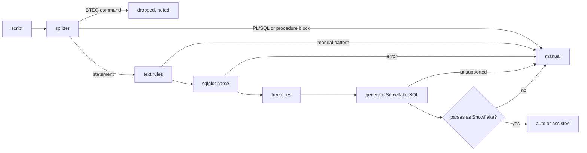
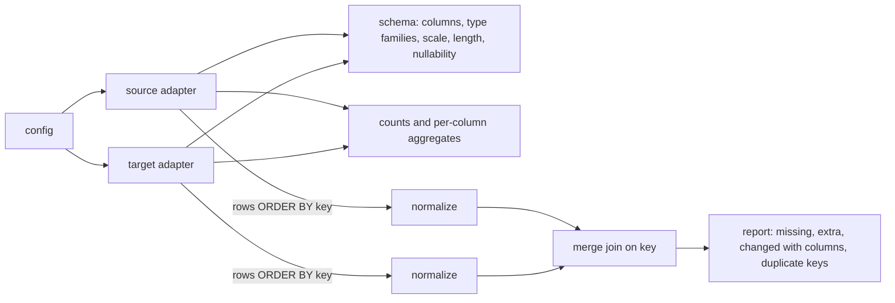

# Architecture

## Translation

- **Splitter.** Statements end at semicolons outside strings, comments and parentheses. Teradata
  BTEQ dot-commands are their own pieces. An Oracle PL/SQL block runs to a line holding only `/`;
  a Teradata procedure runs to its matching `END`. Line numbers point at the source file.
- **Text rules** handle syntax sqlglot cannot parse: Teradata `UPDATE ... FROM` (rewritten into
  Snowflake's form and then parsed as Snowflake), `TITLE` phrases, and patterns that mean a
  person is needed (macros, procedures, temporal SQL).
- **Tree rules** run on the parsed statement and change it in place: table properties and
  indexes, column attributes, `ROWNUM`, `(+)` joins, `SYSTIMESTAMP`, Oracle `DATE` and unbounded
  `NUMBER`, `TO_DATE` with a time, date arithmetic, `INDEX()`. Each change adds a note with a
  severity: `info` is informational, `warning` makes the statement *assisted*, `manual` stops it.
- **Verification.** The generated SQL must parse back with sqlglot's Snowflake grammar.

## Assessment

The assessment runs the same translation over every file and counts statuses, rules and object
kinds. Effort is `sum(hours[status])` with explicit, configurable weights. They are a starting
point for planning; a pilot on real code is how a team should calibrate them.

## Validation

- **Adapters** expose column metadata, counts, aggregates and a key-ordered row stream
  (server-side cursors on PostgreSQL). Text keys use a byte-wise collation so engines agree on
  order. If a stream comes back out of order anyway, the comparison restarts holding that
  table's keys in memory, and the report says so.
- **Normalization** is per side: a source can be told its naive timestamps are local time while
  the target's are UTC. Rules are off by default.
- **Type families** (integer, decimal, float, string, date, timestamp, boolean, binary) are
  compared, with explicit widenings allowed (integer to decimal, date to timestamp).
